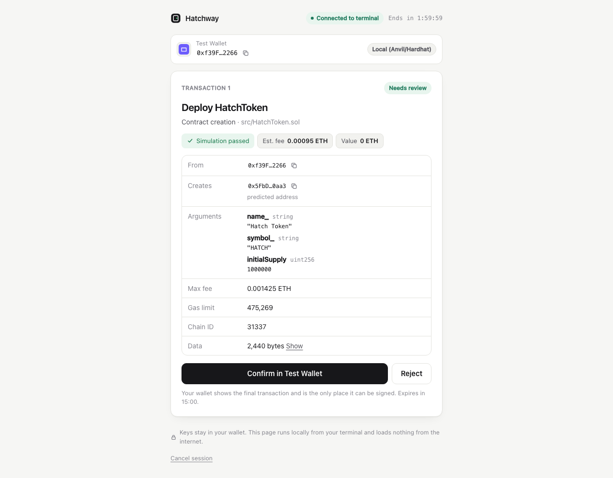

# Hatchway

**Deploy from your terminal. Approve with your wallet. Keep your keys.**

Hatchway runs your existing Foundry scripts and Hardhat 3 tasks with your browser wallet
(MetaMask, Rabby, or any EIP-6963 wallet) as the signer. It prints a link to a local review
page; you connect your wallet, check each decoded transaction, approve it in the wallet, and
your terminal carries on — with addresses, hashes, receipts and broadcast files exactly where
your tools normally put them. Your private key never leaves the wallet.

<p align="center">
  
</p>

- **Your workflow, unchanged.** `forge script`, `hardhat run`, Hardhat Ignition, `cast`,
  viem and ethers keep working. Hatchway sits in front of your RPC endpoint and only takes
  over the signing calls.
- **Real review before signing.** Contract names and constructor arguments are decoded from
  your build artifacts, each request is simulated, and fees are estimated — not raw JSON.
- **Safe by construction.** Loopback-only server, one-time pairing, strict CSP, DNS-rebinding
  and CSRF protection, and every broadcast transaction is checked against what you approved.
- **Built for automation.** `--json` emits NDJSON events, so scripts and AI coding agents can
  prepare deployments while a human approves each transaction.

> Status: **0.1.0, pre-release.** Verified end-to-end on Anvil with forge 1.6 and Hardhat 3.21
> using a deterministic test wallet; manual MetaMask/Rabby acceptance testing is documented but
> pending. Not yet published to npm. See [PROJECT_STATUS.md](PROJECT_STATUS.md).

## Contents

[Quickstart](#quickstart) · [Install](#install) · [Foundry](#foundry) · [Hardhat](#hardhat) ·
[Other tools](#other-tools-connect) · [How it works](#how-it-works) · [Security](#security-model) ·
[Compatibility](#compatibility) · [Troubleshooting](#troubleshooting) · [Docs](#documentation)

## Quickstart

Five minutes, on a local Anvil node, with the example project in this repository.

**You need:** Node.js 22+, [Foundry](https://getfoundry.sh), and a browser with MetaMask or
Rabby. Until Hatchway is published to npm, build it from source (one minute):

```bash
git clone https://github.com/successaje/hatchway && cd hatchway
```

```bash
pnpm install && pnpm build && npm link ./packages/hatchway
```

1. **Start a local chain** in its own terminal:

   ```bash
   anvil
   ```

2. **Prepare your wallet.** Add the network `http://127.0.0.1:8545`, chain id `31337` (or let
   Hatchway offer to add it), and fund your account from Anvil's first dev account:

   ```bash
   cast send --unlocked --from 0xf39Fd6e51aad88F6F4ce6aB8827279cffFb92266 --rpc-url http://127.0.0.1:8545 <your-wallet-address> --value 10ether
   ```

3. **Deploy** from the example project:

   ```bash
   cd examples/foundry
   ```

   ```bash
   hatchway forge script/DeploySystem.s.sol --rpc-url http://127.0.0.1:8545 --broadcast
   ```

4. **Approve.** Your browser opens the session. Connect your wallet, review each of the five
   transactions, and confirm each one in the wallet.

5. **Check the result** in your terminal (addresses, hashes, receipts) and on-chain:

   ```bash
   cast call <registry-address> "owner()(address)" --rpc-url http://127.0.0.1:8545
   ```

This is what the terminal printed in a real run against Anvil (lines omitted, none edited;
the approvals were given by the deterministic test wallet the automated tests use):

```text
Hatchway  forge script script/DeploySystem.s.sol

  Project    foundry (Foundry 1.6.0-nightly)
  Network    Local (Anvil/Hardhat) · chain 31337 · http://127.0.0.1:63241/

  Open this link in the browser where your wallet is installed:
  http://127.0.0.1:63249/s/BimPRdz4MMkXVKH8C1_pCA#OCNiToOQWkgFWHu1J4qVV8SMzcsAN4lta9jA4UlFHVM

  ○ Browser connected. Waiting for your wallet…
  ✓ Wallet connected · Test Wallet
  Address    0xf39Fd6e51aad88F6F4ce6aB8827279cffFb92266

  ○ Running forge script…

  forge │ Script ran successfully.
  forge │ Estimated total gas used for script: 1192501
  ● 1. Deploy HatchToken — review it in your browser
    args: "Hatch Token", "HATCH", 1000000000000000000000000
    Waiting for approval in Test Wallet…
  ✓ Submitted 0xd42cfe3862b95a6ff2fc8d759893a1e8cb6fb5cdf2b0631a583f6e232bd66cb7
  ✓ Confirmed block 1 · fee 0.000475 ETH
    HatchToken deployed at 0x5FbDB2315678afecb367f032d93F642f64180aa3

  ● 2. Deploy Registry — review it in your browser
  …
  ● 5. Registry.transferOwnership — review it in your browser
    args: 0x000000000000000000000000000000000000bEEF
    to: 0xe7f1725E7734CE288F8367e1Bb143E90bb3F0512
    Waiting for approval in Test Wallet…
  ✓ Confirmed block 5 · fee 0.000016 ETH

  forge │ ONCHAIN EXECUTION COMPLETE & SUCCESSFUL.

  ✓ Deployment successful

  Contract   HatchToken
  Address    0x5FbDB2315678afecb367f032d93F642f64180aa3
  Tx         0xd42cfe3862b95a6ff2fc8d759893a1e8cb6fb5cdf2b0631a583f6e232bd66cb7

  Contract   Registry
  Address    0xe7f1725E7734CE288F8367e1Bb143E90bb3F0512
  Tx         0xf7e16997c3dfac783203813b9b3624c6545561f8311d9dea2b3594b0f9f32dd1

    plus 3 other transactions
  Network    Local (Anvil/Hardhat) (31337)
  Deployer   0xf39Fd6e51aad88F6F4ce6aB8827279cffFb92266
  Forge log  broadcast/DeploySystem.s.sol/31337/run-latest.json
  Run record .hatchway/runs/2026-11-01T10-00-24-546Z-31337.json
```

The step-by-step version, including MetaMask setup, is in
[docs/guides/first-deployment.md](docs/guides/first-deployment.md).

## Install

Hatchway is a Node.js CLI (Node 22 or newer). No Docker, database, cloud account or API key.

| Method                                 | Command                                                                                                 |
| -------------------------------------- | ------------------------------------------------------------------------------------------------------- |
| From source (works today)              | `pnpm install && pnpm build && npm link ./packages/hatchway`                                            |
| From a release tarball                 | `npm install -g ./hatchway-0.1.0.tgz` (build one with `pnpm --filter hatchway pack`)                    |
| From npm (**after the first release**) | `npm install -g hatchway`, or per project: `npm install -D hatchway`, or zero-install: `npx hatchway …` |

Then check your setup:

```bash
hatchway doctor --rpc-url http://127.0.0.1:8545
```

More in [docs/guides/installation.md](docs/guides/installation.md).

## Foundry

Run your script exactly as before, with `hatchway forge` in front and without any signer flags:

```bash
hatchway forge script/Deploy.s.sol --rpc-url sepolia --broadcast --verify
```

Hatchway resolves `--rpc-url` (URL, `foundry.toml` alias, or `ETH_RPC_URL`), waits for your
wallet, then runs `forge script` with `--unlocked --sender <your wallet> --slow` against a
local bridge. Forge simulates, estimates and writes `broadcast/` artifacts as usual; every
`eth_sendTransaction` goes to your wallet. Options for Hatchway itself go **before** the script
path, e.g. `hatchway forge --no-open --port 9555 script/Deploy.s.sol …`.

Supported, partially supported and unsupported script features are listed in the
[compatibility matrix](docs/guides/foundry.md#compatibility-matrix).

## Hardhat

Add the plugin (Hardhat 3):

```ts
// hardhat.config.ts
import hatchway from "hatchway/hardhat";

export default defineConfig({
  plugins: [hatchway /* , hardhatEthers, … */],
  networks: {
    sepolia: { type: "http", url: configVariable("SEPOLIA_RPC_URL") }, // no `accounts` needed
  },
});
```

Then run any task through Hatchway:

```bash
hatchway hardhat run scripts/deploy.ts --network sepolia
```

```bash
hatchway hardhat ignition deploy ignition/modules/Token.ts --network sepolia
```

`ethers.getSigners()` returns your wallet's account, and deployments, calls, `signMessage`
and typed-data signatures are approved in the wallet. The plugin is inert unless Hardhat is
started by `hatchway hardhat`. See [docs/guides/hardhat.md](docs/guides/hardhat.md).

## Other tools: `connect`

`hatchway connect` keeps a wallet session open and prints a local JSON-RPC endpoint. Anything
that sends `eth_sendTransaction` can use it — `cast send --unlocked`, viem or ethers with a
JSON-RPC account, Hardhat 2 networks, custom scripts:

```bash
hatchway connect --rpc-url http://127.0.0.1:8545
```

```bash
cast send --unlocked --from <your-wallet> --rpc-url <printed-endpoint> <to> "setNumber(uint256)" 42
```

And for a single compiled contract:

```bash
hatchway deploy HatchToken --rpc-url http://127.0.0.1:8545 --args "Hatch Token" HATCH 1000000
```

## How it works

```text
 forge / hardhat / cast                 Hatchway (loopback only)                  Browser
 ─────────────────────                  ────────────────────────                  ───────
 eth_call, eth_estimateGas ──────────▶  JSON-RPC bridge ──── reads ───────────▶  your RPC endpoint
 eth_sendTransaction ────────────────▶  approval queue ─┐
                                          (nonce order,  │  review data via SSE
                                           de-duplicated)└─────────────────────▶ review page ──▶ wallet
                          tx hash  ◀──── integrity check ◀── hash ◀──────────────  (eth_sendTransaction)
                                         (fetch tx, compare from/to/data/value/nonce)
```

The wallet signs **and broadcasts**; tools receive the transaction hash, never a raw signed
transaction. Requests are shown one at a time, each only after the previous one is mined, so
the review and simulation reflect the state the transaction will actually run against. Forge
retries timed-out and rejected sends; retries join the open approval (or get the same answer)
instead of prompting again. Architecture details: [docs/architecture/decisions.md](docs/architecture/decisions.md).

## Security model

Hatchway never asks for a seed phrase, private key, keystore or wallet password, and stores
no signing material. The wallet is the only signer and the final authority.

| Surface             | Protection                                                                                                                                                             |
| ------------------- | ---------------------------------------------------------------------------------------------------------------------------------------------------------------------- |
| Network exposure    | Binds `127.0.0.1` only; never `0.0.0.0`. Remote use goes through SSH port forwarding.                                                                                  |
| DNS rebinding       | Every request must carry a loopback `Host` header.                                                                                                                     |
| Session link        | Random 128-bit session id; 256-bit **single-use** pairing code in the URL _fragment_ (not sent to the server, not in `Referer`), removed from the address bar on load. |
| Browser API         | Bearer token from the pairing exchange, same-origin `Origin` required (CSRF), strict CSP, no third-party code.                                                         |
| Tool RPC endpoint   | 256-bit token in the path, passed to forge in its environment (not its arguments); rejects browser requests; forwards only read methods.                               |
| Approval integrity  | Requests are bound to session, account, chain and payload hash; the broadcast transaction is fetched and compared with what was approved.                              |
| Replays and retries | Results are accepted once per request; hashes are released only after verification; retried sends get the original outcome, never a new approval.                      |

Full threat model and known limitations: [docs/guides/security.md](docs/guides/security.md) and
[docs/research/security-considerations.md](docs/research/security-considerations.md). This is an
automated and self-reviewed design that has also had an independent code review (all findings
fixed, see the threat model), but **not** a professional security audit.

## Compatibility

| Area     | Verified                                                                                                                                                                                 |
| -------- | ---------------------------------------------------------------------------------------------------------------------------------------------------------------------------------------- |
| Foundry  | forge 1.6.0-nightly (2026-04) — scripts, multi-tx, proxies, CREATE2 decoding, `--verify` passthrough                                                                                     |
| Hardhat  | Hardhat 3.21 — `run` with ethers, `signMessage`, Ignition                                                                                                                                |
| Wallets  | EIP-1193 + EIP-6963 wallets. Automated tests use a deterministic wallet; MetaMask/Rabby: manual test pending                                                                             |
| Networks | Any EVM chain with standard CREATE semantics; names/explorers for common chains (`hatchway chains`)                                                                                      |
| OS       | Full suite (unit, integration, E2E): macOS arm64 locally, Linux x64 and macOS arm64 in CI. Unit and security tests also on Linux arm64, macOS x64 and Windows x64 in CI (Node 22 and 24) |

Not supported: Hardhat 2 via `hatchway hardhat` (use `connect`), Hardhat's in-process network,
`forge script --multi`, raw signed transactions (`eth_signTransaction`), EIP-7702 and blob
transactions, mobile wallets. Details in [docs/guides/foundry.md](docs/guides/foundry.md) and
[docs/guides/hardhat.md](docs/guides/hardhat.md).

## Troubleshooting

| Symptom                             | Fix                                                                                            |
| ----------------------------------- | ---------------------------------------------------------------------------------------------- |
| "No browser wallet found"           | Open the link in the browser where MetaMask/Rabby is installed.                                |
| Stuck on "Check your wallet"        | The wallet is on another network or account; use the switch button or change it in the wallet. |
| MetaMask "nonce too high" on Anvil  | Anvil was restarted. MetaMask → Settings → Advanced → Clear activity tab data.                 |
| `forge` fails after ~4 minutes      | Approve within forge's retry window (about 4 minutes per transaction on forge 1.6).            |
| Link opened on a remote/SSH machine | Forward the port: `ssh -N -L <port>:127.0.0.1:<port> host`, and use `--port`.                  |

More: [docs/guides/troubleshooting.md](docs/guides/troubleshooting.md). `hatchway doctor` checks
most of these automatically.

## Documentation

- Guides: [installation](docs/guides/installation.md) ·
  [first deployment](docs/guides/first-deployment.md) · [Foundry](docs/guides/foundry.md) ·
  [Hardhat](docs/guides/hardhat.md) · [wallets](docs/guides/wallets.md) ·
  [networks](docs/guides/networks.md) · [remote development](docs/guides/remote-development.md) ·
  [automation and AI agents](docs/guides/automation.md) · [security](docs/guides/security.md) ·
  [troubleshooting](docs/guides/troubleshooting.md) ·
  [manual wallet acceptance test](docs/guides/manual-acceptance.md)
- Reference: [CLI](docs/reference/cli.md) · [JSON events](docs/reference/json-events.md) ·
  [Hardhat plugin](docs/reference/hardhat-plugin.md)
- Background: [competitive landscape](docs/research/competitive-landscape.md) ·
  [Foundry integration](docs/research/foundry-integration.md) ·
  [Hardhat integration](docs/research/hardhat-integration.md) ·
  [architecture decisions](docs/architecture/decisions.md)

## Contributing

Issues and pull requests are welcome. See [CONTRIBUTING.md](CONTRIBUTING.md) for the
development setup (`pnpm install && pnpm build && pnpm test`) and [SECURITY.md](SECURITY.md)
for reporting vulnerabilities privately.

## License

[MIT](LICENSE)
